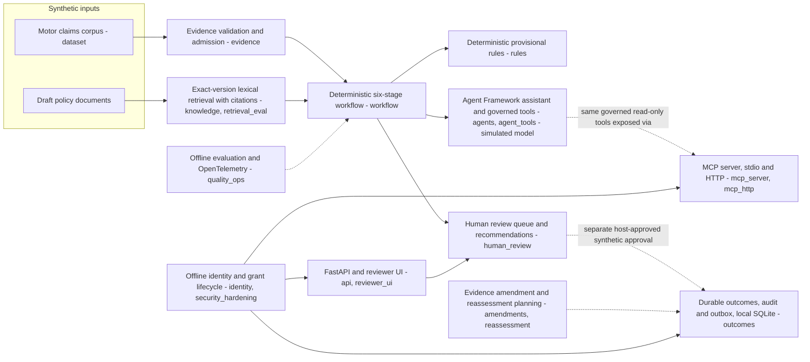

# Enterprise Azure Agentic AI Claims Processing Platform

## Overview

An **offline, evidence-governed reference implementation** of agentic AI claims processing for
the fictional **Northstar Insurance Group** (motor damage claims). It assembles and validates
claim evidence, retrieves exact-version policy clauses with citations, applies deterministic
rules, prepares bounded agent-assisted recommendations and routes every case outcome to an
authorised human, with durable audit throughout.

**Status: OFFLINE COMPLETE / DEPLOYMENT BLOCKED.** The system runs entirely offline on synthetic
data. It is **not deployed and not production-ready**; cloud deployment is deliberately held by
an unresolved container security gate (see [Deployment Status](#deployment-status)).

Status terms used throughout: **Implemented** = code with recorded tests. **Simulated** = a real
contract exercised with stubbed or fixture behaviour. **Planned** = design only. **NOT_TESTED** =
no recorded evidence.

## Architecture

### Implemented offline architecture

Every component below is tested code running locally on synthetic data. Labels are
`claims_ai` packages. Dashed edges mark deliberate separations: an advisory recommendation never
becomes a case outcome by itself.



### Target Azure architecture (planned, not deployed)

The [target architecture](docs/architecture/target-architecture.md) describes the intended cloud
design. **None of it is deployed or connected.** Each item is **PLANNED**: Azure Container Apps;
PostgreSQL case state and audit; Blob evidence quarantine with malware scanning; Service Bus;
Azure Document Intelligence; Microsoft Foundry models; Azure AI Search hybrid retrieval; Entra ID
and managed identities; API Management; Application Insights. Only offline Bicep, workflow and
policy artifacts exist, with deployment gates disabled.

## Core Capabilities

| Capability | Implemented and tested (offline) | Simulated | Planned / NOT_TESTED |
| --- | --- | --- | --- |
| **Agentic AI orchestration** | Microsoft Agent Framework SDK; governed read-only tools with host grants; deterministic six-stage workflow; MCP server over stdio and HTTP | **Model responses are simulated: no live LLM is called** | Live Microsoft Foundry models: planned |
| **Evidence grounding and retrieval** | Source/hash-verified evidence admission; byte-verified policy parsing; **exact-version lexical retrieval with clause citations** and abstention; offline retrieval evaluation | Extraction benchmark results are fixture echoes | **Semantic/vector or hybrid RAG (Azure AI Search): planned, not implemented** |
| **Human-in-the-loop governance** | Assigned review queues; supervisor escalation and separation of duties; durable human outcomes with audit, receipts, corrections and reopening (local SQLite); evidence-amendment planning | — | Wiring UI recommendations to durable outcomes: not implemented |
| **Security and DevSecOps** | Offline identity with key rotation and revocation; least-privilege grants; adversarial suite; supply-chain admission checks; recorded container-security decision | Synthetic identities, not Entra ID | Entra ID, API Management enforcement, managed identity: NOT_TESTED |
| **Evaluation and operations** | Offline evaluation harness; OpenTelemetry instrumentation; fault injection with real process crashes | Development labels, not an independent benchmark | Independent quality review: NOT_TESTED |
| **Azure infrastructure** | Offline-validated Bicep, OIDC workflow and API Management policy | Infrastructure procedures tested with local stubs | Application deployment blocked. Infrastructure-only Stage 6 execution pending |

Details: [agents](docs/architecture/agent-framework-foundation.md) ·
[tools](docs/architecture/governed-agent-tools.md) ·
[workflow](docs/architecture/deterministic-claims-workflow.md) ·
[MCP](docs/architecture/governed-mcp-server.md) ·
[evidence](docs/architecture/structured-evidence-processing.md) ·
[retrieval](docs/architecture/policy-knowledge-retrieval.md) ·
[human review](docs/architecture/governed-human-review.md) ·
[durable outcomes](docs/architecture/governed-durable-outcomes.md) ·
[quality and operations](docs/architecture/offline-quality-and-operations.md).

## Technology Stack

| Area | Technology |
| --- | --- |
| Language and contracts | Python 3.12; Pydantic 2.14.2; pydantic-settings 2.16.2 |
| Agents and tools | Microsoft Agent Framework core 1.23.0; Model Context Protocol SDK 2.2.0 |
| API and UI | FastAPI 0.162.2; Starlette 1.10.0; Uvicorn 0.54.0; server-rendered HTML |
| Identity and cryptography | PyJWT 2.15.1; cryptography 50.0.2 |
| Persistence and audit | SQLite (Python standard library), local only |
| Observability | OpenTelemetry SDK 1.45.2 |
| Quality tooling | pytest; Ruff; strict mypy |
| Infrastructure as code | Bicep (8 modules); GitHub Actions (static validation; OIDC deployment workflow disabled); API Management policy XML |

Pins are defined in [`pyproject.toml`](pyproject.toml) and the
[constraint files](requirements/).

<a id="run-it"></a>

## Quick Start

Requires Python **3.12** (`>=3.12,<3.13`). From the repository root:

```sh
python3.12 -m venv .venv
.venv/bin/python -m pip install -c requirements/m22-constraints.txt '.[dev,mcp,ui,identity,observability]'
make check
```

`m22-constraints.txt` chains the earlier constraint files. The `observability` extra installs
the pinned OpenTelemetry SDK that the evaluation and operations code imports. Use a
non-editable install on managed macOS filesystems, where hidden editable `.pth` files can be
skipped. Component-level commands are in the [engineering notes](docs/milestones/milestone-notes.md).

<a id="m22-stage-b--offline-evaluation-and-operations"></a>

## Testing and Verification

`make check` runs Ruff formatting and lint checks, strict mypy and the full pytest suite.

- **Recorded M25 source-tree run: 1,775 passed, 0 failed, 0 skipped** on CPython 3.12.8, macOS arm64, using
  the source tree. This is **not** installed-wheel, Linux, container or deployment verification.
- **Adversarial suite: 80 PASS / 0 FAIL / 8 NOT_TESTED** across workflow, tools, MCP, API/UI,
  human review and identity controls ([threat model](docs/architecture/ai-threat-model-and-adversarial-testing.md)).
- **Independent quality evaluation: NOT_TESTED.** 60 candidate cases await genuine independent
  review; 12 quality gates are NOT_TESTED ([record](docs/milestones/milestone-22-stage-b.md)).
- **End-to-end demonstrations: NOT_TESTED.** All six are blocked because an approved execution
  sandbox couldn't be established ([record](docs/milestones/milestone-24.md)).

## Security and Governance

- **Human authority:** agents and rules produce advisory output only. Every case outcome needs
  an authorised human; supervisors handle escalations; self-review is refused
  ([decision authority](docs/architecture/decisions/0001-decision-authority.md)).
- **Identity and access:** offline identity verification, key rotation and revocation,
  least-privilege grants and durable revocation checks
  ([hardening](docs/architecture/security-and-identity-hardening.md)).
- **Auditability:** append-only, replay-verified audit records, idempotent receipts and
  tamper detection for durable outcomes.
- **Supply chain:** exact-version dependency constraints, hash-verified artifact admission for
  container builds, and a recorded
  container-security decision ([security and governance](docs/architecture/security-and-governance.md)).

What this repository does **not** claim:

- no live LLM, OCR or Azure AI service is called;
- no semantic, vector or hybrid RAG;
- no cloud deployment, real authentication, production persistence or hosting;
- no independent quality score;
- no real insurance data, payments, customer communications or autonomous claim decisions.

## Deployment Status

**APPLICATION DEPLOYMENT BLOCKED.** The separate Option C infrastructure validation has a Stage 6
approval for November 25, 2026. ARM validation and what-if remain pending, and Stages 7–9
require separate decisions. Both repository Bicep gates are false-only. The owner previously
created the subscription budget described in the infrastructure record.
[Execution and closure runbook](docs/deployment/infrastructure-validation.md#execution-and-closure-runbook).

| Gate | Status | Record |
| --- | --- | --- |
| Container security (M23) | **SECURITY GATE NO-GO.** Nine High OS-package vulnerabilities in the candidate base image have unresolved applicability; Debian signing-key provenance is unverified; container builds stay disabled | [Record](docs/milestones/milestone-23.md) · [remediation handoff](docs/deployment/m23/security-remediation-blocked-handoff.md) · [minimal-runtime design](docs/deployment/m23/b1-p1-minimal-runtime-design.md) |
| Independent quality review (M22) | Pending; 60 cases PENDING_REVIEW, 12 gates NOT_TESTED | [Record](docs/milestones/milestone-22-stage-b.md) |
| End-to-end demonstrations (M24) | Execution blocked; all six NOT_TESTED | [Record](docs/milestones/milestone-24.md) |
| Evidence amendments (M25) | **OFFLINE COMPLETE**; operational integration unauthorised and NOT_TESTED | [Record](docs/milestones/milestone-25.md#m25-completion-offline-complete) |

Deployment strategy and gates: [deployment strategy](docs/deployment/deployment-strategy.md).

## Documentation

| Area | Documents |
| --- | --- |
| Business | [Charter](docs/business/project-charter.md) · [requirements](docs/business/requirements.md) · [traceability](docs/business/traceability-matrix.md) · [risk register](docs/business/risk-register.md) |
| Architecture | [Target architecture](docs/architecture/target-architecture.md) · [security and governance](docs/architecture/security-and-governance.md) · [decision records](docs/architecture/decisions/) |
| Quality | [Evaluation and observability](docs/quality/evaluation-and-observability.md) · [extraction benchmark](docs/quality/document-intelligence-benchmark.md) · [retrieval evaluation](docs/quality/policy-retrieval-evaluation.md) |
| Data | [Synthetic motor corpus](data/synthetic/motor/README.md) · [provisional rules](data/rules/motor/README.md) |
| Engineering records | [Roadmap and status definitions](docs/milestones/roadmap.md) · [engineering notes](docs/milestones/milestone-notes.md) · verification evidence linked from each record |

All people, policies, identifiers, documents and images are fictional or synthetic. Binding
underwriting, autonomous rejection and fraud adjudication are out of scope.
