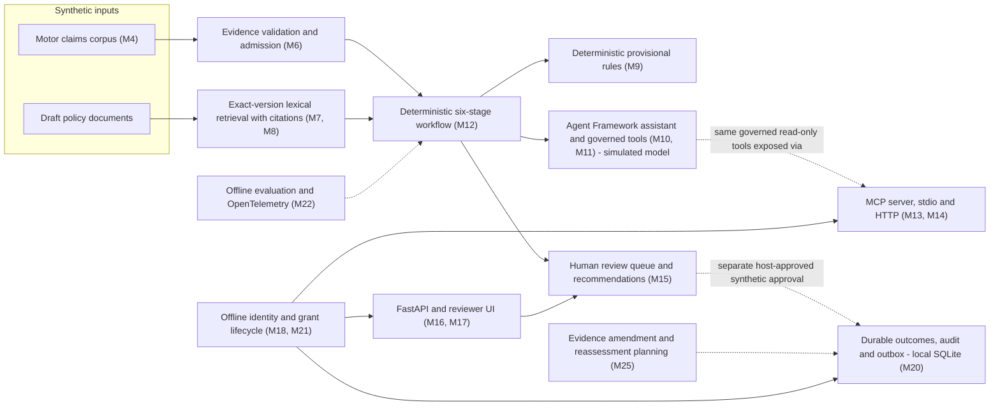

# Enterprise Azure Agentic AI Claims Processing Platform

An **offline, evidence-governed reference implementation** of agentic AI claims processing for
the fictional **Northstar Insurance Group** (motor damage claims). It is engineered to
production standards: typed contracts, deterministic workflow, human authority, security
testing and supply-chain gates. It runs **entirely offline on synthetic data. It is not
deployed and is not production-ready.**

## At a glance

**Status: OFFLINE COMPLETE / DEPLOYMENT BLOCKED.** All 25 milestones are delivered within
their recorded offline scopes. Cloud deployment is deliberately blocked by an unresolved
container security gate, not by missing code.

Legend: **Implemented** = real code with recorded tests. **Simulated** = a real contract
exercised with stubbed or fixture behaviour. **Planned** = design only. **NOT_TESTED** = no
recorded evidence.

| Capability | Implemented and tested (offline) | Simulated | Planned / NOT_TESTED | Read more |
| --- | --- | --- | --- | --- |
| **Agentic AI orchestration** | Real Microsoft Agent Framework SDK; governed read-only tools with host grants; deterministic six-stage workflow; real MCP server over stdio and HTTP | **Model responses are simulated: no live LLM is called** | Live Microsoft Foundry models: planned | [Agents](docs/architecture/agent-framework-foundation.md), [tools](docs/architecture/governed-agent-tools.md), [workflow](docs/architecture/deterministic-claims-workflow.md), [MCP](docs/architecture/governed-mcp-server.md) |
| **Evidence grounding and retrieval** | Source/hash-verified evidence admission; byte-verified policy parsing; **exact-version lexical retrieval with clause citations** and abstention; offline retrieval evaluation | Extraction benchmark results are simulated fixture echoes | **Semantic/vector or hybrid RAG (Azure AI Search): planned, not implemented** | [Evidence](docs/architecture/structured-evidence-processing.md), [retrieval](docs/architecture/policy-knowledge-retrieval.md), [evaluation](docs/quality/policy-retrieval-evaluation.md) |
| **Human-in-the-loop governance** | Assigned review queues; supervisor escalation and separation of duties; durable human outcomes with audit, receipts, corrections and reopening (local SQLite); evidence-amendment planning | — | Wiring UI recommendations to durable outcomes: not implemented | [Review](docs/architecture/governed-human-review.md), [outcomes](docs/architecture/governed-durable-outcomes.md), [ADR-0001](docs/architecture/decisions/0001-decision-authority.md) |
| **Security and DevSecOps** | Offline identity with key rotation and revocation; least-privilege grants; adversarial suite **80 PASS / 0 FAIL / 8 NOT_TESTED**; supply-chain admission checks; CVE triage producing a recorded NO-GO | Synthetic identities, not real Entra ID | Entra ID, APIM enforcement, managed identity: NOT_TESTED | [Threat model](docs/architecture/ai-threat-model-and-adversarial-testing.md), [hardening](docs/architecture/security-and-identity-hardening.md), [M23 gate](docs/milestones/milestone-23.md) |
| **Testing and evaluation** | **1,775 tests pass** (full source tree); Ruff; strict mypy; offline evaluation harness; fault injection with real process crashes | Development labels are not an independent benchmark | Independent quality review: **60 cases PENDING_REVIEW; 12 gates NOT_TESTED** | [Quality and operations](docs/architecture/offline-quality-and-operations.md), [M22](docs/milestones/milestone-22-stage-b.md) |
| **Azure architecture** | Bicep modules, OIDC workflow and APIM policy as **static, offline-validated** artifacts; disabled deployment gates | — | **No Azure resource has been deployed**; cloud integration NOT_TESTED | [Target architecture](docs/architecture/target-architecture.md), [deployment foundation](docs/architecture/offline-azure-deployment-foundation.md) |

## Run it

Requires Python **3.12** (`>=3.12,<3.13`). From the repository root:

```sh
python3.12 -m venv .venv
.venv/bin/python -m pip install -c requirements/m22-constraints.txt '.[dev,mcp,ui,identity,observability]'
make check
```

`make check` runs Ruff formatting and lint checks, strict mypy and the full pytest suite.
The latest recorded run: **1,775 passed, 0 failed, 0 skipped** on CPython 3.12.8, macOS
arm64, using the source tree. That is not installed-wheel, Linux, container or deployment
verification. `m22-constraints.txt` chains the earlier constraint files, and the
`observability` extra installs the pinned OpenTelemetry SDK that the M22 code and tests
import. Use a non-editable install on managed macOS filesystems (see the
[M14 record](docs/milestones/milestone-14.md)). Per-component commands are in the
[detailed milestone notes](docs/milestones/milestone-notes.md).

## Implemented offline architecture

Everything below exists as tested code running locally on synthetic data. Dashed edges mark
deliberate separations: an advisory recommendation never becomes a case outcome by itself.



## Target Azure architecture (planned, not deployed)

The [target architecture](docs/architecture/target-architecture.md) describes the intended
cloud design. **None of it is deployed or connected.** Each item below is **PLANNED**:
Azure Container Apps hosting; PostgreSQL case state and audit; Blob evidence quarantine with
malware scanning; Service Bus work queues; Azure Document Intelligence; Microsoft Foundry
models; Azure AI Search hybrid retrieval; Entra ID and managed identities; APIM; Application
Insights. Only the offline Bicep, workflow and policy artifacts exist, with deployment gates
disabled ([deployment strategy](docs/deployment/deployment-strategy.md)).

## Limitations and security-gate status

What this repository does **not** claim:

- No live LLM, OCR or Azure AI service is called; agent and extraction behaviour is simulated.
- No semantic, vector or hybrid RAG; retrieval is lexical over draft synthetic policies.
- No cloud deployment, real authentication, production persistence or production hosting.
- No independent quality score: the M22 held-out review has not happened.
- No real insurance data, payments, customer communications or autonomous claim decisions;
  every outcome needs an authorised human.

| Gate | Status in plain language | Record |
| --- | --- | --- |
| **M22 independent review** | Evaluation infrastructure is built; the 60 candidate cases await a genuine independent reviewer, and 12 quality gates are NOT_TESTED | [M22](docs/milestones/milestone-22-stage-b.md) |
| **M23 container security** | **SECURITY GATE NO-GO.** Nine High OS-package vulnerabilities in the candidate base image have unresolved applicability; Debian signing-key provenance is unverified; container builds stay disabled | [M23](docs/milestones/milestone-23.md), [handoff](docs/deployment/m23/security-remediation-blocked-handoff.md), [minimal-runtime design](docs/deployment/m23/b1-p1-minimal-runtime-design.md) |
| **M24 demonstrations** | Execution blocked because a sandbox couldn't be established; **all six end-to-end demonstrations NOT_TESTED** | [M24](docs/milestones/milestone-24.md) |
| **M25 amendments** | **OFFLINE COMPLETE**; operational integration unauthorised and NOT_TESTED | [M25](docs/milestones/milestone-25.md#m25-completion-offline-complete) |

## Milestones

| Range | Delivered (offline, synthetic) | Records |
| --- | --- | --- |
| M1–M3 | Charter, architecture, Python foundation, requirements and traceability | [M1](docs/milestones/milestone-1.md), [M2](docs/milestones/milestone-2.md), [M3](docs/milestones/milestone-3.md) |
| M4–M9 | Synthetic corpus, extraction benchmark, evidence admission, policy retrieval and evaluation, deterministic rules | [M4](docs/milestones/milestone-4.md) · [M5](docs/milestones/milestone-5.md) · [M6](docs/milestones/milestone-6.md) · [M7](docs/milestones/milestone-7.md) · [M8](docs/milestones/milestone-8.md) · [M9](docs/milestones/milestone-9.md) |
| M10–M14 | Agent Framework, governed tools, workflow orchestration, MCP server and HTTP transport | [M10](docs/milestones/milestone-10.md) · [M11](docs/milestones/milestone-11.md) · [M12](docs/milestones/milestone-12.md) · [M13](docs/milestones/milestone-13.md) · [M14](docs/milestones/milestone-14.md) |
| M15–M21 | Human review, FastAPI, reviewer UI, identity, adversarial testing, durable outcomes, hardening | [M15](docs/milestones/milestone-15.md) · [M16](docs/milestones/milestone-16.md) · [M17](docs/milestones/milestone-17.md) · [M18](docs/milestones/milestone-18.md) · [M19](docs/milestones/milestone-19.md) · [M20](docs/milestones/milestone-20.md) · [M21](docs/milestones/milestone-21.md) |
| M22–M25 | Quality and operations, Azure deployment foundation, readiness evidence, evidence amendments | [M22](docs/milestones/milestone-22-stage-b.md) · [M23](docs/milestones/milestone-23.md) · [M24](docs/milestones/milestone-24.md) · [M25](docs/milestones/milestone-25.md) |

The [roadmap](docs/milestones/roadmap.md) defines scope, exit evidence and status vocabulary.
The [detailed milestone notes](docs/milestones/milestone-notes.md) preserve the previous
README's per-milestone narrative and commands verbatim.

## Key documents

| Area | Documents |
| --- | --- |
| Business | [Charter](docs/business/project-charter.md) · [requirements](docs/business/requirements.md) · [traceability](docs/business/traceability-matrix.md) · [risk register](docs/business/risk-register.md) |
| Architecture | [Target architecture](docs/architecture/target-architecture.md) · [security and governance](docs/architecture/security-and-governance.md) · [ADRs](docs/architecture/decisions/) |
| Quality | [Evaluation and observability](docs/quality/evaluation-and-observability.md) · [extraction benchmark](docs/quality/document-intelligence-benchmark.md) |
| Data | [Synthetic motor corpus](data/synthetic/motor/README.md) · [provisional rules](data/rules/motor/README.md) |

All people, policies, identifiers, documents and images are fictional or synthetic. No
production insurance data, automated payment, binding underwriting, autonomous rejection or
fraud adjudication is in scope.
