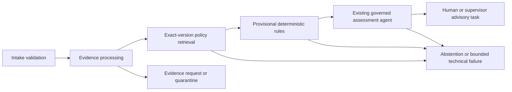

# Deterministic offline claims workflow

Status: **IMPLEMENTED and locally TESTED**, with real M11 Microsoft Agent Framework dispatch and **SIMULATED** chat, scan/identity and reviewer-fact assertions. This is host orchestration of existing local components, not a live intake API or deployed workflow service. [M12 evidence](../milestones/milestone-12.md) records verification.

## Stages and authority

[WorkflowRunner](../../src/claims_ai/workflow/engine.py) executes an explicit six-stage sequence. [LocalStages](../../src/claims_ai/workflow/stages.py) calls existing implementations; it does not copy normalization, policy selection, insurance arithmetic or agent tools. No additional agent is introduced.

| Stage | Prerequisites and implemented calls | Result / safe stop |
| --- | --- | --- |
| Intake | Validate M2 Case/Claim/Document contracts, initial state/revision, case-bound grant, unique document submissions and explicitly simulated fixture origin | M2 `transition_case`: RECEIVED → VALIDATING → EXTRACTING; invalid/unauthorized input rejected |
| Evidence | M6 `process_extraction`, shared immutable history, `admit_evidence(allow_simulated=True)` and M2 required-document validation | Accepted fields/admissions retained, M2 transition to ASSESSING; missing evidence → AWAITING_EVIDENCE, malformed/conflicting/unverified inputs → QUARANTINED |
| Policy | M7 `ingest` and unchanged lexical `retrieve`, with host-fixed query and exact claim/policy/version/incident date/snapshot | Verified chunks/citations or abstention; absent/expired/conflicting versions never fall back |
| Rules | M9 `evaluate` over replayable evidence and exact provisional policy specification | Six non-binding findings; binding/evidence prerequisites must PASS before agent execution |
| Agent | M11 `assess` with a host-derived same-case grant, three governed read-only tools, typed result and M10 provenance validator | Real SDK orchestration with simulated responses; unsupported conclusions/tool access abstain, transient tool failures can retry |
| Routing | Revalidate the advisory draft and minimum reviewer | Typed human-review task; ambiguous, high-risk, adverse or uncertain findings require supervisor review |



Workflow state is deliberately separate from operational case outcomes. M2's `AWAITING_REVIEW` requires an operational `Assessment`, which provisional M9/M11 findings must not fabricate. A successful workflow therefore leaves the case **ASSESSING**, with no operational assessment/decision, and creates a separate advisory `ReviewTask`. This preserves [ADR-0001](decisions/0001-decision-authority.md). No tool/agent can approve, deny, pay, settle or close the case. All workflow/checkpoint/task contracts fix human approval required, final outcome null and settlement authority false.

## Identity, scope and untrusted content

The caller supplies a trusted M11 `ToolGrant` over the initial intake fingerprint. Case/fingerprint and all three read permissions are checked **before checkpoint replay or services**. After verified M2 transitions and M6 admissions, the host derives a grant over the same claim's current fingerprint; the model cannot supply or alter that delegation. Every M11 tool repeats authorization, exact policy/date/index checks and output-provenance validation. These are trusted synthetic assertions, not authentication or authorization-token verification.

The intake is a validated local DTO plus preauthored synthetic extraction responses. There is no file upload endpoint, scanner or live extractor. M6 verifies the supplied fixture bytes/quotes; original document quarantine and simulation limits remain unchanged. Reviewed facts are never silently rebound by runtime orchestration. The demo authoring helper explicitly creates synthetic assertions for its expected future revision; stale or absent assertions remain uncertain and require a supervisor.

Document/policy text remains lower-trust tool-result data. The injected-document demo reauthors only an in-memory synthetic narrative and byte/source references, then passes it through M6/M7/M9/M11. It supplies no new human fact and routes to a supervisor. This proves deterministic guards and channel separation with a scripted client, not live-model injection resistance. M8's four lexical failures remain unresolved.

## Records, idempotency and checkpoints

[Contracts](../../src/claims_ai/workflow/contracts.py) define stages, states, stage outcomes, review tasks, immutable snapshots and hash-linked `StageRecord` / `Checkpoint` objects. Records include correlation, sequence, stage/attempt, outcome/code, input/output/previous hashes, snapshots and any available typed agent attempt. M2 transitions and M6 admissions are retained. Transition event IDs derive deterministically from execution key/state/revision; times are caller-supplied fixture assertions, not measured wall-clock audit evidence.

The execution key binds the request, principal/correlation/grants, limits, runtime versions, all package Python source bytes and **actual extraction input bytes**, which existing model dumps exclude. Identical inputs on one runner reuse its checkpoint and do not invoke the agent again. An async lock serializes that runner; its journal has 32-entry capacity and no automatic eviction. There is no separate queue-wait deadline, cross-process lock or durable exactly-once guarantee. A new runner needs an explicit checkpoint to avoid recomputing work.

Successful deterministic stages are replayed against original inputs before outputs advance and when restoring a checkpoint. This reuses existing pure validators and costs extra local CPU; it is not a new policy/extraction implementation. Agent outputs are rechecked against deterministic evidence/rules/citations without rerunning the model. Ordering, attempt bounds, input fingerprints, correlation and record chains must match. Rehashed forged provenance, transitions or conclusions are rejected.

Hashes detect changes and bind content; **they do not authenticate records or attest that an SDK call occurred**. A caller able to author an unsigned checkpoint can assert a canonical scripted result or a technical failure. Treat checkpoint files as trusted synthetic artifacts. Signed storage, authenticated principals, tamper-evident durable audit and independent execution attestation remain future requirements.

## Retry and terminal behavior

Defaults: at most **two attempts per stage**, 15 seconds per processing invocation after journal-lock admission, including measured setup/replay, three seconds per stage, M11's own three-second/four-response/three-tool bounds, 4 MiB per checkpoint and 8 MiB of fixture input bytes. Stage verification is inside the cooperative deadline. Synchronous Python/serialization cannot be preempted; external blocking clients need isolation. Checkpoint/input/journal capacity violations raise sanitized validation errors and do not publish oversized state.

Only dependency errors, cooperative timeouts and cancellation consume retryable attempts. A failed stage retains its previous processing data; exhausted retries add only a supervisor review task. No partial stage result advances. Attempts are recorded across resumes and cannot reset. Cancellation records the attempt in the runner's journal before propagating; abrupt process loss can still lose uncommitted work. Agent attempts with available results retain actual reported response/tool counts; an interrupted call's unavailable counts are not invented. Read-only stages allow immediate bounded retry without backoff in this offline scope.

`pause_on_retry=True` returns a resumable checkpoint after the first technical failure; `stop_after=Stage.POLICY` creates a successful boundary checkpoint. Exhausted failures are terminal. Business/provenance/authorization holds are not retried. Terminal states are human review, supervisor review, awaiting evidence, quarantine, abstained, failed or rejected; none is an insurance outcome. Supplied stale prefixes use the runner's latest verified checkpoint; divergent branches are rejected.

## Reproduction

```sh
PYTHONPATH=src .venv/bin/python -m claims_ai.workflow --output outputs/workflow/offline-v1.json
make workflow-check
```

Use a new output filename. Seven report cases cover advisory success, missing evidence, retrieval outage, injected source content, adverse/high-risk escalation and checkpoint resume. Duplicate runs and serialized resume are checked internally; full immutable checkpoint records are included in JSON. Reference directories and overwrites are protected, including from another working directory.

Library recovery: retain the returned checkpoint, optionally serialize it with `model_dump_json()` and load it with `Checkpoint.model_validate_json()`, then pass it to a new runner's `run(request, grant, checkpoint=...)` with identical inputs/configuration/runtime. Original byte-bearing inputs must be supplied separately. Checkpoints contain synthetic case/evidence content and need protected storage before any real service use. This library support supplies neither a cloud store nor a CLI persistence daemon.
