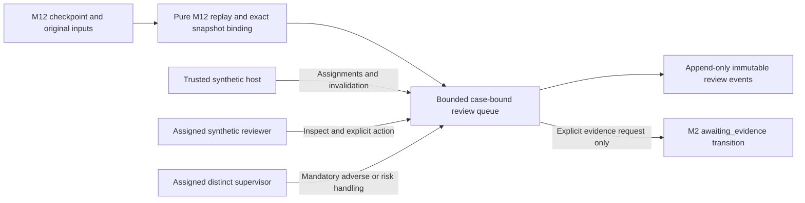

# Governed human review — M15

Status: implemented offline synthetic recommendation review. There is no API, UI, real authentication, durable storage or claim-outcome commit. See [M15 evidence](../milestones/milestone-15.md).

## Authority and data flow

M12 deliberately ends with an ASSESSING case and an advisory task, not the operational M2 Assessment needed for AWAITING_REVIEW/CLOSED. M15 therefore introduces a separate recommendation-review state machine. Approval means a synthetic human accepts an advisory recommendation for later work; rejection means the recommendation is unsuitable. Neither creates a `ReviewerDecision`, populates a final outcome, closes a case, denies coverage or authorizes settlement/payment.



Admission calls M12's existing `execution_key`/`restore` and independently replays all recorded prerequisites, including actual extraction bytes, policy retrieval, rule findings and advisory validation. It does not rerun the model. A rehashed invented review task is rejected. A terminal review/supervisor advisory with a validated draft is reviewable. A rule/agent abstention with a complete case, exact policy and rule context can enter supervisor evidence triage, with `recommendation_available=False`; it cannot be approved or rejected. Partial, missing-context and earlier blocked checkpoints remain in M12's exception flow.

The binding pins claim ID, exact case revision/hash, evidence/documents/history hash, policy ID/version/bundle hash, index hash, rule version/specification/execution hashes, workflow execution/checkpoint hashes, advisory-task hash and advisory-result hash. Evidence references pin document/artifact, processing key and immutable processing-record hash. The action must carry the exact binding plus the current review revision and explicit evidence references.

## Synthetic identity and separation of duties

The trusted host constructs a finite registry of synthetic principals and opaque `ReviewSession` objects. Every call checks the registered object identity and canonical principal. A serialized dictionary, copied session or claimed role cannot authenticate. The host must deliver a human session only to the corresponding synthetic human; this is a local capability boundary, not Entra, a signed token or proof that a real person acted.

Only the synthetic host can admit verified M12 work, assign a case/task or invalidate a snapshot. Human roles reuse M2's `ReviewerRole`; an agent, MCP client, simulated model or host has no reviewer role and cannot read or decide. There is no review method registered among the unchanged three M11/M13/M14 tools. Possession of a tool grant does not grant review authority.

Assignments are exact entry/binding grants. A reviewer or supervisor has no global case access. Reassignment revokes the previous assignee's view/action authority; authorization precedes duplicate-receipt return. The workflow producer and every M9 reviewed-fact author are prohibited from reviewing that advisory, including as supervisor. The host cannot assign them around this restriction.

## Review states and actions

| Current review state | Permitted human action | Result / authority |
| --- | --- | --- |
| `awaiting_reviewer` | Approve or reject recommendation | Terminal `recommendation_approved` / `recommendation_rejected`; case remains ASSESSING |
| `awaiting_reviewer` | Request additional evidence | Terminal `additional_evidence_requested`; existing M2 transition moves the case to AWAITING_EVIDENCE and increments its revision |
| `awaiting_reviewer` | Escalate | `awaiting_supervisor`; subsequent decisions require the assigned supervisor |
| `awaiting_supervisor` | Approve/reject available recommendation or request evidence | Assigned supervisor only; no claim-outcome authority |
| Supervisor exception with no recommendation | Request evidence | Assigned supervisor only; approval/rejection forbidden |
| Completed or invalidated review | New human action | Denied; an exact authorized duplicate returns its existing immutable receipt without applying again |

M9 FAIL/INDETERMINATE findings, risk flags (including ambiguous/high-risk/conflicting), or M12 supervisor routing require a supervisor. An ordinary assignee may inspect such a task but cannot approve, reject or request evidence on it. Initial supervisor routing cannot be downgraded by review arguments.

Every action requires its matching reason code, nonblank rationale, a timezone-aware host-checked timestamp, and unique known source references. An evidence request additionally names missing document kinds. A future or backdated action, changed duplicate, unknown evidence reference, stale expected review revision or mismatched binding fails before mutation.

## In-memory concurrency and audit

`ReviewQueue` serializes mutations with a process-local `RLock`. The current review revision supplies optimistic concurrency control: competing incompatible actions at one revision have one winner; identical concurrent actions return one receipt. Entry/event/current-binding/head updates occur under that same lock. The read-only `ReviewDetails` object provides assigned queue listing and source-linked detail, without action methods.

Each queued, assigned, decision or invalidation event records the canonical actor/kind/role, action/request identity, rationale/time, correlation, before/after review states, source references and previous/current SHA-256. Evidence requests retain the actual validated M2 transition. Before reads/actions, independent replay checks actor/assignment/transition semantics as well as hashes against the stored source. A separate in-memory head detects truncated/rolled-back entry histories. Returned models and nested histories are frozen; there is no public history replacement/import method.

The host must call `invalidate` whenever authoritative evidence, case, policy, rules or task identity changes. That appends a reasoned invalidation and records replacement binding metadata; it does not process or approve replacement evidence. Old actions and duplicate acknowledgements then fail stale. A new task requires fresh M12 verification matching the host's replacement binding. The host is responsible for reporting upstream changes; there is no shared service repository or automatic version watcher.

Defaults bound the registry to 64 principals, queue to 16 entries, each entry to 64 events and 4 MiB serialized projection/source snapshot, and each decision to 16 KiB. Limits have typed upper bounds; capacity failures retain the old state. Denied calls return fixed error codes without case data and do not consume an accepted-action audit event. Failed-attempt telemetry, durable denial logs and retention are future work.

The journal disappears on process exit. Hashes are unsigned and are not WORM retention, signatures, distributed CAS, durable transactions or protection against a same-user host that can replace code/private memory. No restart/import authenticity or operational outcome commit is claimed.

## Demonstration and remaining limits

```sh
make review-check
PYTHONPATH=src .venv/bin/python -m claims_ai.human_review --output outputs/review/new-review.json
```

Use a new output filename. Six scenarios show recommendation approval, rejection, escalation followed by supervisor handling, evidence request, stale evidence and unauthorized access. One upstream M12 advisory is prepared with the existing simulated SDK path; review admission/replay/actions make zero model calls. The report labels synthetic host identity/clock and non-durable storage. Reference-data paths and existing outputs cannot be overwritten.

M8 Q-007/Q-012/Q-015/Q-029 remain unresolved. M12's real cooperative deadlines can change retry histories under load; exact-byte report reproduction remains timing-sensitive. New modules also change M12's whole-package fingerprint and future task keys by design. Historical data/evaluation artifacts are preserved. Real identity, session delivery/revocation, durable audit/outbox, authenticated API, reviewer UI, approved policy publication and operational claim outcomes remain future scopes.
