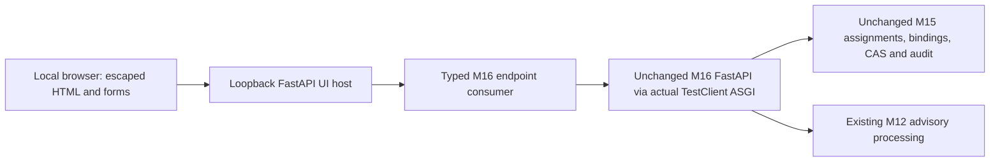

# Governed reviewer operations UI — M17

Status: implemented offline presentation over the existing M16 HTTP contracts. See [M17 evidence](../milestones/milestone-17.md), [M16 API](governed-fastapi-application.md), [M15 authority](governed-human-review.md) and [ADR-0001](decisions/0001-decision-authority.md). No insurance-outcome authority is added.

## Technology and service reuse

The UI uses the already installed FastAPI 0.162.2, Starlette 1.10.0 and Uvicorn 0.54.0, with standard-library HTML escaping and server-rendered HTML/CSS. Streamlit is absent from the existing environment; adding its dependency and session/runtime stack is unnecessary for a queue, source detail and explicit form submissions. No new distribution, JavaScript framework, template engine, remote asset, browser storage or client-side model call is needed. The optional `ui` extra declares the existing minimal API dependencies plus the existing Uvicorn pin; [M17 constraints](../../requirements/m17-constraints.txt) retain the M16/M13/M10 closure.



The UI host has a separate local browser port, default `127.0.0.1:8767`. Its lifespan-managed backend TestClient uses M16's exact `127.0.0.1:8766` ASGI metadata. This is real request routing/validation, not a second review service or evidence of backend TCP. No browser-supplied API URL or bearer token is accepted. A future deployed transport must preserve the API boundary rather than broaden this demo into a proxy.

Explicit host startup registers the existing M16 fixtures and seeds intake/processing through the real API, using host-only permissions. Existing M12 simulated model execution remains unchanged. The default reviewer retains M16's first-case-only API scope; the supervisor retains its host-configured assignments. Cases blocked before a reviewable M15 task, such as missing-estimate, remain workflow exceptions outside the assigned review queue. The UI does not manufacture a recommendation for them.

## Screens and actions

- Synthetic session page: one-time host code; no editable actor, role, case grant or backend address.
- Assigned dashboard: bounded page of case links, pending action and supervisor counts, review state, recommendation availability and case/review revisions. Counts describe the current page, not an undisclosed global total. Escalated reviews display their current supervisor requirement.
- Case detail: current case context, admitted evidence values/document/page/artifact hashes, extraction metadata and uncertainty, verified source locations/processing-record hashes, retrieved policy text/citations, provisional rule findings, simulated agent advisory, exact server-held snapshot and append-only audit trace. No source-owned document URL is followed or turned into a download link. The existing API supplies provenance; the UI does not perform independent document inspection or retrieval.
- Explicit action form: approve advisory recommendation, reject advisory recommendation, request additional evidence or escalate to supervisor. Rationale and selected source references are mandatory; evidence requests name missing document kinds. The form's visible choices never authorize an action. M15 remains the authority for supervisor requirements, missing recommendations, separation of duties, completed states and exact bindings.
- Receipt/error views: only a validated API event produces a success receipt. An uncertain failure says success is unconfirmed, not that nothing happened. Stale/conflicting actions require reloading and reconsidering the case; the UI never silently refreshes bindings and submits again.

Approving a recommendation does not approve a claim, deny coverage, create a final M2 assessment/decision, close a case or authorize payment/settlement. Evidence requests alone can invoke M15's existing guarded M2 AWAITING_EVIDENCE transition. No intake, assignment, invalidation, policy publication or outcome controls are exposed in the browser.

## Synthetic sessions and write integrity

The trusted local host delivers separate random 256-bit one-use enrollment codes for the already scoped reviewer and supervisor API capabilities. Codes expire after five minutes and are stored as hashes. They are printed only to the host console during explicit `serve`; reports and HTML captures never record codes, browser cookies or API tokens. Possessing a code proves only receipt of a synthetic capability, not real human identity.

Login requires an anonymous server session, its CSRF nonce and an exact same-origin POST. Successful enrollment consumes the code and rotates the cookie and CSRF nonce. The opaque HttpOnly/SameSite=Strict cookie contains no actor, role, cases or bearer token. Active sessions expire after 15 absolute monotonic minutes; anonymous sessions expire after five. Logout removes the UI session. API capability revocation is enforced again by M16; UI expiry/logout does not claim to revoke the host's underlying API capability.

The browser form contains a random ticket, CSRF nonce, action, rationale and evidence selections. Its full M15 binding, review revision and canonical evidence references remain in a server-held snapshot. On first submission the host constructs the existing typed ReviewDecision, UUID idempotency key and strong If-Match revision. Timestamping uses the existing fixed M15 synthetic scenario clock, separately from real monotonic session expiration. An exact retry retains the original decision/time/key and reaches the API again; changed replays fail. There is no UI success cache that can survive revoked API authority. Concurrent identical actions retain one event; competing actions retain one winner through existing M15 CAS.

Default UI bounds: eight anonymous/active sessions total, eight outstanding enrollment codes, 16 login attempts for the host process, four pending action tickets per session (oldest evicted), eight in-flight browser requests, 8 KiB actual form bytes/32 fields, 16 KiB/64 decoded headers, three-second cooperative body timeout and 2 MiB buffered HTML responses. Admitted requests retain their in-flight slot until response sending completes, including slow-client backpressure. Codes/session entries are purged by monotonic expiry; accepted decisions and snapshots are volatile. Reloading too many login pages, exhausting attempts or losing host codes can require waiting or restarting this finite demo.

## Browser safety and accessibility

Exact IPv4 loopback peer/server/Host and same-origin POST checks reject proxy/identity headers, browser bearer credentials and query parameters. CSRF is checked on login, logout and every action. Forms are UTF-8, URL-encoded, bounded and attachment-free. Duplicate scalar fields and unknown trusted-field submissions fail. Responses are buffered before release; oversized or unexpectedly failed rendering discards partial content and returns a fixed safe error.

All source, evidence, policy, advisory, labels and attribute values pass through HTML escaping. There is no Markdown, raw-source HTML or script execution. CSP blocks scripts, external resources, framing and base changes; a hash permits only the fixed inline stylesheet. No-store, nosniff, no-referrer and disabled browser capability headers apply to all pages. The launcher disables access logging and suppresses raw server exception logs; safe errors contain no payload, token, stack trace or case data on denied access. There is no durable security/denial telemetry claim.

Semantic landmarks, a skip link, explicit field labels/fieldset legends, table captions/column headers, text status labels, error/status roles, visible keyboard focus and a narrow-screen layout support accessibility. Native controls work without JavaScript. Multi-select document kinds use the platform's keyboard conventions. These are structural checks, not a WCAG certification, screen-reader audit or measured mobile/browser compatibility result. Visual browser validation remains a separate limit in M17 evidence.

## Running and reproducing

```sh
.venv/bin/python -m pip install -c requirements/m17-constraints.txt '.[dev,mcp,ui]'
.venv/bin/python -m claims_ai.reviewer_ui serve
```

Open the printed `/login` URL and enter the corresponding host-delivered code. For simultaneous reviewer/supervisor use, use separate browser profiles/private windows; they share a cookie name on one host. Do not share host codes, bind publicly, configure a proxy, add real data or treat this as authentication. Restarting loses all in-memory work and audit. The local host/OS user can replace code/private memory or misdeliver capabilities.

```sh
make ui-check
PYTHONPATH=src .venv/bin/python -m claims_ai.reviewer_ui demo \
  --output outputs/ui/new-report.json --html-dir outputs/ui/new-html
```

Use distinct new paths outside reference data. The demonstration runs actual UI and M16 TestClient requests, including every action, supervisor enforcement, stale review/replay and cross-case denial. Four sanitized HTML captures retain the real rendered screens with nonce/ticket values redacted and submission buttons disabled; they are offline evidence, not active authenticated sessions or screenshots. No TCP, TLS, APIM, Entra or cloud dependency enforcement is inferred.

M8 Q-007/Q-012/Q-015/Q-029 remain unresolved. M12 timing-dependent retry/reproduction and M15 volatile identity/audit limitations remain. New UI modules extend the existing whole-package fingerprint and future advisory/task IDs; historical evidence is preserved. Real identity/session delivery, TLS/ingress, durable audit/outbox and recovery, distributed storage, production telemetry, authenticated artifact access and full accessibility/usability/browser testing require later work. Stop after M17; no M18 implementation is included.
