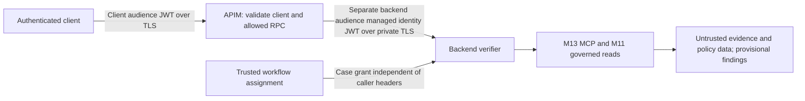

# MCP HTTP and gateway boundary — M14

Status: **IMPLEMENTED and TESTED through ASGI and externally supplied real loopback TCP evidence**, using the real MCP SDK. The TCP report matches current HTTP source; shutdown evidence is qualified in the M14 record. This execution sandbox still denies socket binding. APIM/Entra enforcement and cloud hosting remain **PLANNED**. See [M14 evidence](../milestones/milestone-14.md) and the [APIM reference](../deployment/apim-governance-reference.md).

## Implemented transport

[HttpBoundary](../../src/claims_ai/mcp_http/transport.py) composes the unchanged M13 `GovernedMCP`, which invokes M11 services. MCP 2.2.0 `StreamableHTTPSessionManager`, `TransportSecuritySettings`, `Client` and `streamable_http_client` perform genuine initialization, discovery and calls. The bounded profile is stateless JSON responses on POST `/mcp`; it does not offer optional GET/SSE sessions. Existing stdio and Agent Framework MCP integration remain available. No new agent or business rule is introduced.

Exactly `read_claim_evidence`, `read_policy_clauses` and `read_rule_findings` are exposed. Their M11 strict schemas, exact policy/version/date/index/execution scope, provenance replay, correlation, safe replies and human authority remain unchanged. One host-selected case context lasts for one short-lived demonstration: inherited M13 limits permit three attempts, one use per tool, serialized execution and failure latching. This is not a multi-user service or durable session store.

The HTTP layer independently requires a verified gateway service identity **and** a matching trusted case grant selected by the host. Its default verifier denies everything. RPC arguments, metadata, client tokens and headers cannot construct grants or select the trusted principal. A gateway token proves a service identity only; future authenticated workflow assignment must independently supply and revoke case authority.

The local test verifier uses PyJWT 2.15.1 / cryptography 50.0.2 to verify RS256 signatures with a pinned public key, synthetic issuer/audience, exact subject/application/role and a maximum 60-second lifetime. The issuer generates fresh keys in memory; credentials are neither embedded nor serialized. This is **synthetic cryptographic validation**, not Entra authentication, OAuth discovery or managed identity. Entra tokens are intentionally rejected. Production needs a separate reviewed verifier with tenant/issuer/audience/application validation, key rotation and authorization lifecycle.

## Bounds and safe failures

- Hard-coded IPv4 loopback binding, exact socket/Host authority, same-origin checks and no forwarded-header trust. Uvicorn disables proxy parsing and access logs. There is no public bind option or unauthenticated demo mode.
- POST JSON only; no compression, batches, duplicate JSON keys, query credentials, unlisted RPC methods or mutating tools. Actual received bytes are capped at 16 KiB independently of `Content-Length`.
- At most 12 authenticated requests per 60 seconds in one process; new token IDs do not reset the counter. HTTP rate limiting and M11/M13 tool budgets are separate. `429` carries `Retry-After`; this local deque is not a distributed gateway quota.
- The manager's `max_sessions=1` argument is ineffective with `stateless=True`; it imposes no session or concurrent-request cap. The actual controls are the request/rate/time bounds and inherited serialized tool budgets.
- A five-second cooperative HTTP deadline and existing narrower tool limits apply. Sanitized pre-response failures return 401/403/400/413/415/429/503/504 as appropriate; governed service failures return typed MCP error results. After response start, an interrupted response may be truncated rather than replaced.
- Responses set no-store/nosniff. CLI SDK/access payload logging is suppressed. Retrieved text remains explicitly untrusted data; no instruction becomes executable authority or a claim outcome.

The ASGI test surface exchanges actual HTTP request/response envelopes through official MCP clients and the SDK manager without replacing SDK implementations. It does not prove TCP framing, Uvicorn startup, TLS, network isolation or proxy interoperability. `demo --mode loopback` implements that separate socket path; see the evidence record for the supplied successful TCP report, shutdown-evidence limits and reproduction command.

The demonstration requires a successful typed result matching each expected tool and agreement between structured and text content. An error flag, missing/malformed result or reply for another tool aborts the demonstration before any success report is written. This includes an expired governed server. The APIM static validator checks both the exact `roles` claim name and `Claims.Read` value; live APIM enforcement remains unverified.

## Future trust boundary

Both arrows and the assignment service are **design only**. The local loopback verifier is not deployable as an APIM backend: it rejects non-loopback peers and lacks production TLS/Entra trust. Future work must implement the reviewed hosting boundary, private ingress, grant issuer/revocation and backend authentication before exposure. Do not relax the local boundary to make a public listener work. No tool can mutate a case, approve, deny, pay or settle; human/supervisor gates remain authoritative.

Residual limits include trusted same-user host/code, replay within credential lifetime, no durable audit/revocation, single-process budgets, cooperative cancellation and SDK/pre-handler allocations. These controls do not prove live-model prompt-injection resistance. M8 Q-007/Q-012/Q-015/Q-029 remain unresolved.
