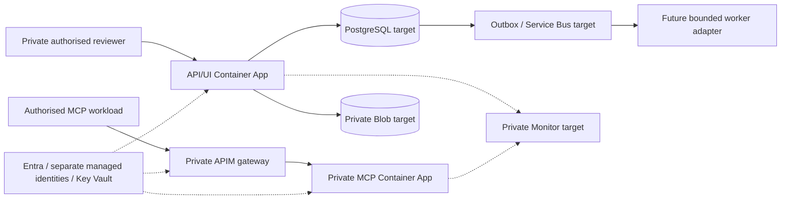

# Offline Azure deployment foundation — M23 Stage A

Status: implemented definitions and local contracts only; no Azure access or deployment. Official milestone title remains **Governed Azure deployment**. Stage A is a preparatory subset and cannot satisfy the roadmap's actual Azure integration/identity/smoke/cost exit evidence. [Deployment strategy](../deployment/deployment-strategy.md), [contract](../../deployment/contract.json), [Bicep](../../infra/azure/README.md).

Current M23 container deployment status: **DEFERRED — SECURITY GATE NO-GO**. The [milestone record](../milestones/milestone-23.md) distinguishes retained Stage A/B1 and artifact/static achievements from unresolved findings. Reopening needs supported fixes or independently approved applicability, authenticated package/provenance evidence, complete authenticated database bytes within B1's 1 GiB cap, CPython/OpenSSL/Cargo/native coverage and separate acquisition/build/runtime approvals. This status update changes no resource, runtime or identity boundary.

## Smallest synthetic dev slice

The candidate slice uses registered synthetic bundles, the existing advisory/review paths and three read-only MCP tools. It exposes no new insurance outcome, assignment/publication or arbitrary upload endpoint. Model behaviour stays simulated; no new agent or autonomous outcome is added. M20's separate explicit synthetic human-outcome service remains separate from M15 recommendation approval and the browser.

Every box is a disabled definition or an unimplemented cloud integration, not a deployed service. API/UI and MCP are separate Container Apps in one internal environment. ACR holds future immutable Linux images; VNet, private endpoints/DNS and NSG rules define private reachability. PostgreSQL/Blob/Service Bus are necessary targets for a durable cloud workflow, but their presence in Bicep does not create adapters. A future worker/relay image is not supplied or started until the adapter and transactional delivery contract are approved.

Required resource candidates: network/DNS, private ACR, internal Container Apps environment/API-UI/MCP, distinct managed identities/Key Vault, APIM, PostgreSQL, Blob, Service Bus and private operational monitoring/budgets. Premium ACR/Service Bus and Standard v2 APIM are candidates driven by private-connectivity requirements; their fixed charges remain unpriced/unapproved. Do not provision unused services or downgrade security to make them affordable.

Optional/later services are **not defined or enabled**: Foundry models/projects, Document Intelligence, AI Search/embeddings, Content Safety and live models. OCR, hostile-upload scanning, general policy resolution and hybrid retrieval remain unavailable. No production/test deployment or multi-region failover is implied; test/prod parameter sets demonstrate separate names, identity/data boundaries and disabled state only.

## Fail-closed hosting and authority

The new Bicep modules and entrypoints are deliberately not activatable in Stage A. Every new template parameter permits false only; every resource is conditional and every nested module receives false. Names are environment-bound and the contract leaves subscription, tenant, owner, expiry and budgets null. Two explicit reference image values use a reserved invalid registry/zero digest and are **unconfigured placeholders**, never verified image hashes. The actual build manifest uses null values and rejects missing/placeholder inputs.

Container Apps definitions cap each service at one replica with zero minimum, TLS ingress and future startup/readiness/liveness probes. An internal environment plus public-access denial prevents a public backend design; `external=true` at the app means connected-VNet reachability. The process currently exits 78 before hosting; healthy probes cannot be claimed. Max-one-replica is a cost bound, not a cure for volatile memory, stale sessions or SQLite durability.

Existing M16/M17/M14 loopback/proxy rejection is not weakened. A future cloud host needs a separate, tested TLS/host/origin/proxy policy, real API transport for UI, secure `__Host-` cookies and actual dependency readiness. `/health/ready` currently reports Azure unconfigured; neither its local 200 nor an HTTP liveness probe may be reinterpreted as cloud readiness.

M21 Entra-shaped fixtures remain isolated from runtime identity. A genuine Entra adapter must verify the selected real user/workload flow and independently bind it to canonical sessions, assignments and expiring/revocable case grants. Claims, traces, roles serialized in a database and recovered capabilities cannot create authority. The operator/deployment identity cannot decide claims or publish assessments. The gateway's MI and audience are separate from the client identity and audience; backend token possession still needs an independently issued case/tool grant.

M14's XML supplies a useful three-tool allowlist, bounded RPC, removal of forged headers, separate backend MI credential and zero-payload diagnostics. It remains an app-only proposal and is not delegated human UI authentication. Actual C# execution, inherited/global policy, streaming, rate-limit behaviour and private APIM reachability remain NOT_TESTED. No subscription key alone authorises reads and no direct backend bypass is permitted.

## Deployment and operational boundaries

The workflow definitions are separate from actual GitHub environment protection or Entra federation. Static CI has no Azure identity permission. The manual deployment workflow has a refusing preflight, literal false deployment condition and no login/deployment action. OIDC permission exists only in the never-running future job. Actual server-side reviews, exact trust subjects/audiences and scoped bootstrap/runtime rights remain prerequisites.

No complete production IAM, DNS/egress or Monitor-private-link integration is claimed. Conservative NSGs can block required platform traffic; that is a remaining validation requirement, not permission to add unrestricted internet egress. Internal Container Apps wildcard/A-record DNS needs actual assigned addresses. APIM private-endpoint sequencing and PostgreSQL's selected private endpoint model require separately authorised provider validation. Monitor private-link scope/DNS/collector/alerts are absent; public ingestion/query are disabled.

The [adapter requirements](../deployment/m23/adapter-requirements.md) preserve atomic audit/outbox, current authority before duplicate lookup, original source bytes, independent rollback anchors and bounded delivery. The [lifecycle plan](../deployment/m23/lifecycle-and-approvals.md) prohibits automatic migration, historical rehashing and restoring stale revocation state. Azure revision rollback is insufficient without data/runtime compatibility.

M22's 60 labels remain PENDING_REVIEW and all 12 independent-quality metrics NOT_TESTED. The reviewer-only packet never enters the build context or predictor inputs. M8's four failures, M12 timing sensitivity, M19 80/0/8 and the authoring-alias limitation remain. Source runtime code and dependencies are unchanged, but future Linux/runtime/database changes still require explicit compatibility and recovery evidence. No production security, capacity, budget, residency, model quality or hardware/distributed durability acceptance follows from this foundation.
