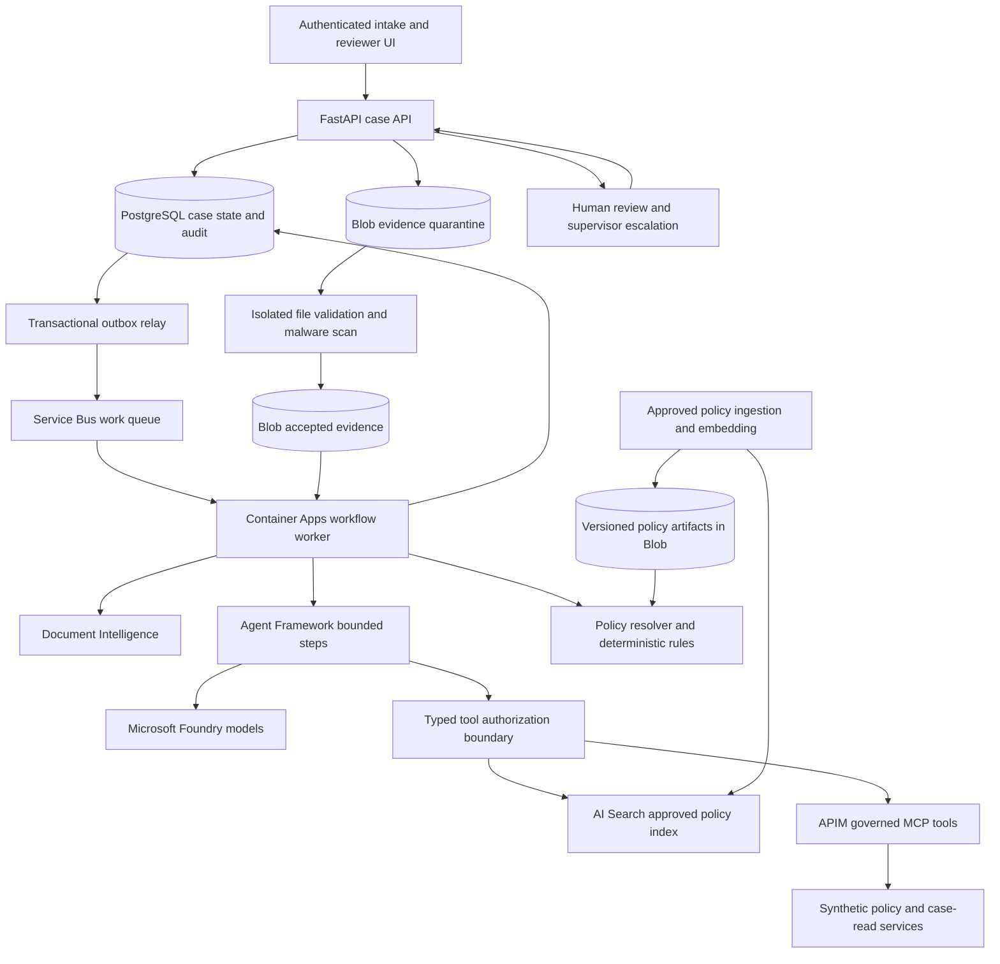

# Target architecture

Status: **PLANNED runtime architecture**. [Milestone 2](../milestones/milestone-2.md) implements and locally tests domain contracts, in-memory transition guards, configuration, redacted logging and typed protocols. [Milestone 3 requirements](../business/requirements.md) refine business acceptance/traceability without changing contracts or this design. Azure services, agents, API/UI, persistence/audit and coverage rules remain unimplemented. This is an independent greenfield design for the [charter](../business/project-charter.md).

[Milestone 4](../milestones/milestone-4.md) adds offline synthetic artifact authoring, source-linked annotations and byte/reproduction validation. These tools do not implement any processing component below: intake remains quarantined, and authored labels are not extracted facts, approved policies or operational decisions.

## Logical components and data flow

OpenTelemetry spans/logs/metrics from API, relay, workers, model/tool calls and dependencies will export to Application Insights. The protected audit ledger is separate from sampled operational telemetry.

1. The API authorizes case access, issues a scoped upload path and creates a case with an idempotency key. Uploaded files remain quarantined until type/size, parser and malware checks succeed. A proposed isolated scanning worker must be proven before any model reads a file; unscannable files require review.
2. PostgreSQL commits case changes and outbox events atomically. A relay publishes work; workers tolerate duplicate delivery through step keys, optimistic case revisions and persisted checkpoints. Blob upload completion is verified and hashed before processing; orphan uploads expire by lifecycle policy.
3. Document Intelligence extracts text, layout and fields. A Foundry multimodal step describes visible photo evidence when needed. Normalization validates types, currencies, dates and evidence references; missing fields remain unknown rather than guessed.
4. Deterministic policy resolution uses the synthetic policy register, policy schedule, loss date and endorsements. It must produce one authoritative policy-version bundle. Missing, overlapping or conflicting mappings block assessment and require review.
5. The policy index stores approved clauses with product, jurisdiction, policy ID/version, endorsement, effective interval, page/section, artifact hash and chunk ID. Server-generated filters restrict **both keyword and vector retrieval** to the resolved bundle and authorized scope. Vector queries use prefiltering; no unfiltered fallback is allowed. Empty results cause abstention. Hybrid search combines keyword and vector retrieval ([Microsoft documentation](https://learn.microsoft.com/en-us/azure/search/hybrid-search-overview)); [filter behavior](https://learn.microsoft.com/en-us/azure/search/vector-search-filters) requires explicit configuration.
6. Code evaluates a separately approved, versioned rule pack against validated facts. Results are `eligible`, `ineligible` or `undetermined`, each with rule IDs and evidence references. Coverage dates, exclusions, required evidence, excesses and limits live in code/data rules, never in prompts. Money uses decimal/minor-unit arithmetic. Uncertain facts yield `undetermined`; rule-pack/policy mismatch blocks processing.
7. A reviewer receives the facts, cited clauses, rule trace, draft explanation, uncertainties and escalation reasons. Every initial outcome requires a human action. Adverse, ambiguous, conflicting, injection-flagged or unsupported cases require supervisor review. Human overrides preserve the original assessment and require reasons and evidence.

Policy publication is a separate authorized pipeline: approve artifacts and rule mappings, validate version metadata, index immutable chunks, evaluate retrieval, then activate an index version. Each assessment pins an index version; reindexing cannot silently change an existing recommendation.

## Agent versus code boundaries

[Microsoft Agent Framework](https://learn.microsoft.com/en-us/agent-framework/overview/) is the proposed library for explicit workflows and bounded model/tool steps. PostgreSQL remains the authoritative durable case state; framework checkpoint compatibility and restart behavior require testing. Foundry supplies model inference; hosted-agent deployment is not assumed.

| Proposed agent | Why an agent is justified | Allowed behavior and limits |
| --- | --- | --- |
| Evidence reconciliation agent | Forms, estimates, narratives and photos can describe the same event inconsistently; semantic comparison helps surface contradictions that field validation alone misses. | Read case-scoped evidence through typed tools; propose fact candidates, discrepancies and requests for evidence. Cannot certify truth, change canonical facts or decide coverage. |
| Policy explanation agent | Reviewers need a concise synthesis of applicable clauses, validated facts and rule results, including conflicting evidence. | Retrieve only the resolved policy bundle; draft cited explanations and unresolved questions. Cannot select policy versions, invent rules, override results or approve outcomes. |

Each agent has bounded tool calls, tokens and wall time, schema-validated output and separate instructions/tool grants. A deterministic workflow orders them; no free-running supervisor agent is required. OCR, authorization, retrieval filters, calculations, routing, retries and persistence are ordinary code. Agent necessity must be compared against a simpler non-agent baseline during evaluation; remove complexity if it provides no measurable benefit.

[ADR-0001](decisions/0001-decision-authority.md) records this existing authority boundary. The [requirements traceability matrix](../business/traceability-matrix.md) distinguishes implemented contract/local guards from planned agents, authorization and durable workflow enforcement. Claimant, operator and compliance/audit responsibilities do not add values to the implemented `ReviewerRole` enum.

Typed tools will include `get_case_evidence`, `retrieve_policy_clauses` and `get_rule_assessment`. Schemas will bound arguments/results and carry provenance. Authorization derives case scope from the authenticated workflow, never a model-provided identity. MCP exposes selected read-only synthetic service operations behind APIM; private SDK adapters serve extraction/search. Both paths enforce the same grants. There is no agent tool for final decision, arbitrary HTTP, shell, SQL or file access.

## Contracts and case lifecycle

The table defines the target contracts. Milestone 2 supplies foundation models and validation; real artifact verification, policy approval/resolution, service-produced assessments and durable review/audit enforcement require later milestones. A transition returns a validated in-memory record for future atomic persistence, not evidence of a persisted outcome.

| Contract | Required information |
| --- | --- |
| Claim | Schema version, synthetic case/policy IDs, loss timestamp/timezone, vehicle reference, narrative, claimed amount/currency and case revision |
| Evidence | Evidence ID, artifact hash, media type, source page/bounding region or image reference, extraction method/version, observed value, normalized value, confidence and validation flags |
| Policy bundle | Schedule/wording/endorsement IDs and hashes, effective interval, applicable version, index version and approved rule-pack version |
| Assessment | Input snapshot hashes, model/deployment/prompt/tool versions, rule results, clause/evidence references, uncertainty flags and proposed routing |
| Review/outcome | Assessment revision, reviewer identity/role, approved facts, outcome/reason, overrides, timestamps and append-only audit event IDs |

Confidence scores are not calibrated probabilities. Define thresholds from the synthetic evaluation set. Record concise evidence-backed rationales, not hidden chain-of-thought.

Lifecycle: `received → validating → extracting → assessing → awaiting_review → closed`. Branches are `awaiting_evidence`, `quarantined` and `processing_failed`; recoveries re-enter through explicit authorized transitions. Supervisor review is an assignment within `awaiting_review`. Closing requires an authorized reviewer, current case revision and persisted audit event. Evidence/policy/rule changes invalidate prior assessments and reopen review; agents cannot close cases.

The minimum reviewer UI will show original evidence, corrections, citations, rule trace and approval/override history. Its UI technology is deferred. See [security](security-and-governance.md), [evaluation](../quality/evaluation-and-observability.md) and [deployment](../deployment/deployment-strategy.md) for cross-cutting requirements.
