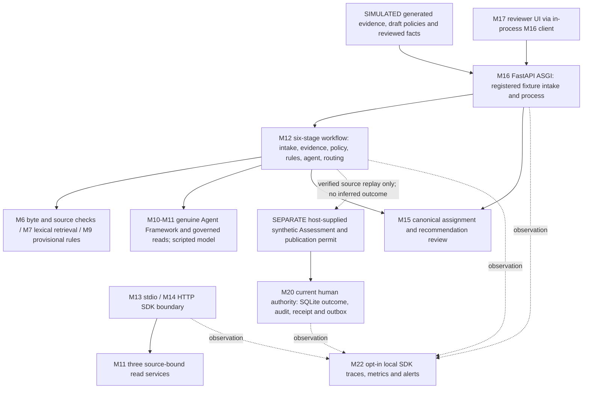

# M24 P2 — Offline architecture reconciliation and demonstration design

**DESIGN ONLY; demonstrations NOT_RUN.** Inspected 2026-11-18 at Git `11a64399d8e0166d2e1087dcb8e43242a7a7b711`. The four existing, uncommitted [P1 documents](../m24-p1/README.md) are preserved. P2 adds documentation only; it grants no execution approval. [Verification](verification.json) records static reference/hash checks, not application validation.

P1's [23-milestone catalogue](../m24-p1/catalogue.json) and [artifact inventory](../m24-p1/evidence-hashes.json) are the traceability baseline. `Axxx` below means that inventory's exact artifact ID. Its 154 file hashes were rechecked; directory references have no single digest. Forty-two P1 references are ignored/local-only: their existence here does not make a fresh checkout evidence-complete. P1 gaps G01–G08 remain open. README/roadmap statements that M24 is unstarted describe the earlier checkpoint; this packet establishes documentation progress only, without rewriting those historical records or claiming M24 completion.

## Implemented architecture

**CONNECTED** means actual local code composition, subject to synthetic inputs. **SIMULATED** describes an input, assertion or provider response, even when genuine SDK code consumes it. **UNIMPLEMENTED/DISABLED** describes an unavailable integration; a target diagram or IaC file does not connect it.



| Layer and P1 binding | Connected implementation / simulation | Unimplemented, separate or limited |
| --- | --- | --- |
| M1–M3 requirements/contracts; M4–M6 sources | Generated development fixtures → fixture extraction responses → byte/quote/admission checks. M4–M6 catalogue entries locate source/manifests and local evidence. | M4 authored expectations are development labels. Original dataset documents remain quarantined; no general OCR, photos, trusted antivirus/upload service or independent ground truth. Workflow helpers author additional in-memory SIMULATED fixtures, not alterations to M4. |
| M7–M12 reasoning; A011/A021–A023/A130/A131/A151/A154 | Exact policy/version/date lexical retrieval, provisional deterministic rules and genuine bounded Agent Framework/tool execution compose inside six workflow stages. | Draft policy approval, live inference, vector search and additional proposed agents are absent. M9 findings/amount illustrations do not become operational Assessments. M8 retains 26/30 with Q-007/Q-012/Q-015/Q-029 failing. M12 deadlines remain cooperative and timing-sensitive. |
| M13–M14 MCP; A027/A030/A142/A143 | Three read-only tools over independently source-bound services; real stdio/HTTP SDK transports. P3 uses existing ASGI HTTP paths only. | MCP is a parallel read interface, not a mandatory remote hop in every M12 execution. APIM policy/IaC is static; current ASGI exercise proves neither real TCP nor cloud APIM. |
| M15–M17 review; A025/A026/A028/A132/A137/A150 | Host-register bundles → API workflow → assigned review queue; UI calls those API routes through TestClient. Real revision, scope, CSRF and supervisor guards. | Queues/application receipts are bounded memory. Recommendation approval leaves the Case ASSESSING, assessment/decision absent and final outcome null. UI HTML captures are not browser/accessibility certification. |
| M18–M21 security/outcomes; A024/A029/A034/A138/A146/A153 | Current synthetic authentication and canonical assignments; optional composed lifecycle gates with authenticated SQLite revocation. M19 corrected baseline is 80 PASS / 0 FAIL / 8 NOT_TESTED. M20 separately registers/publishes supplied synthetic assessments and applies explicit assigned-human actions atomically with audit/outbox. | Entra-shaped pinned fixture verification is not live Entra identity or permission to use a synthetic capability. M21 lifecycle composition must be explicit: the basic API/UI demos use ephemeral capabilities. No automatic API/UI-approval → M20 publication/decision integration exists. M20 outcome fixtures are independently supplied **by the synthetic host**, not independently accepted insurer decisions. Shared-store admission races, independent key/anchor custody and same-runtime recovery remain limitations. |
| M22 operations; A031/A078/A148/A170 | Opt-in genuine OpenTelemetry SDK providers, bounded local sinks, executable dashboard/alert specifications and disposable fault probes observe existing services. | Telemetry is not identity or required business audit. Development parser results are SIMULATED; all 60 candidate cases stay PENDING_REVIEW and 12 independent-quality metrics NOT_TESTED. No held-out scoring/release or live model quality claim. |
| M23 deployment; A001/A084/A159 | Offline IaC, container contracts, verified artifact inventories and security investigation records. | **DEFERRED — SECURITY GATE NO-GO**. No Linux build/run, Azure host, PostgreSQL/Blob/Service Bus production adapter, real Entra/APIM/Key Vault/OIDC or cloud telemetry. B1 unconditionally refuses builds; its 1 GiB database cap and zero-unresolved-Critical/High gate are unchanged. |

M20's [publication and recovery contract](../../architecture/governed-durable-outcomes.md) requires the independently supplied approved input, opaque host publication permit, current canonical human session and assignment. No arrow from API/UI recommendation approval to an M20 human decision is implied. The diagram's source-replay link verifies provenance only. P3 must present the advisory demonstration and synthetic durable-outcome exercise as two explicitly separate authority paths.

## Six-scenario matrix

All predictions/provider responses, host identities, reviewed facts and policy assumptions below are synthetic. Every expected result is a **future assertion**, not a new observed result. Paths are relative to the repository root. G1–G6 refer to the exact execution groups below; CLIs run bundles, not invented per-scenario switches.

| ID / P1 trace | Supported entry point and fixture | Expected result | Capture in fresh P3 directory / limitation |
| --- | --- | --- | --- |
| D01 Normal advisory; M6–M12/M15–M17, A125/A119/A092/A124 | G1 `workflow.offline_report`: `advisory` using `valid-v1` in `data/rules/motor/v1/scenarios.json`; G2 `api.offline_report`; G3 `reviewer_ui.demonstrate`. | Workflow `awaiting_human_review`; API intake 201, processing 200, assigned queue/detail/advisory 200. Recommendation approval 200; duplicates return the same receipt. No automatic Assessment/decision, final outcome null, settlement false. | G1 checkpoint/stage/tool/source hashes; G2 status, ETag/revisions, duplicate bodies and OpenAPI; G3 already-sanitized detail/queue HTML and action-status report. Real SDK/ASGI with scripted model; no production handling-time or quality claim. |
| D02 Missing evidence; M6/M12/M16, A021/A025/A175/A157 | G1 `missing-evidence` uses `missing-estimate`; G6 API early-block test uses the same registered fixture via `demo_application`. | Workflow `awaiting_evidence`, no agent assessment. API `needs_human_attention`, no review entry, advisory draft null. No fabricated recommendation or approval. | G1 hold/code/checkpoint and absent agent result; G6 assertion log for API status/absence. UI's separate conflicting-amounts supervisor exception is not represented as this early missing-evidence path. No upload/resubmission service is added. |
| D03 Supervisor escalation; M12/M15–M17, A021/A026/A028 | G1 `supervisor` / `high-risk` use `gradual-wear-exclusion` / `high-value-threshold`; G3 reviewer escalation; G6 API supervisor-routing test uses `gradual-wear-exclusion`. | Adverse/high-risk workflow routes to supervisor. Ordinary reviewer action on supervisor-bound review 403; current supervisor action 200; stale UI action 409. UI recommendation approval still creates no outcome. | Workflow routing reason/required role; UI `reviewer-escalation`, `supervisor-boundary`, `stale-review-revision`, `supervisor-recommendation-approval`; G6 assertion results. Supervisor approval concerns a recommendation; provisional rules are not policy acceptance. |
| D04 Unauthorised access; M11/M14/M16–M19, A023/A030/A025/A028/A165 | G2 outsider/nonhuman requests; G3 cross-case request; G4 `api_ui_current_authority` and `mcp_three_governed_reads` with `valid-v1`, missing credential and tracing/baggage assertions. | Cross-case assigned detail concealed with 404; nonhuman review 403; no-identity API/MCP 401 despite trace context. Legitimate MCP discovers exactly three read-only tools. No protected action/effect on denial. | Safe status/denial categories, MCP tool count, trace-link booleans, unchanged authority fields. Use G6 API-log/UI-snapshot tests for capture safety. No malicious external endpoint, real credentials or M19 baseline regeneration. |
| D05 Revoked replay; M20/M21/M22, A024/A034/A107/A122/A117 | G4 `api_ui_current_authority`, `revoked_duplicate_after_process_recovery`; G6 lifecycle-composed API/UI and genuine MCP revocation tests. `valid-v1`, existing synthetic grants; M20 fixture from `outcomes.demo.approved_fixture` supplies ELIGIBLE explicitly. | Authorized original approval succeeds; replay after revocation returns 401 through API/UI. Revoked M20 duplicate denied after fresh process, retaining exactly one historical decision/five audit events. Genuine MCP rechecks lifecycle. An old receipt or valid signature cannot restore authority. | Original/duplicate equality flag before revocation, denial after it, recovery counts/current-grant checks and same-context observations. Distinguish ephemeral API revocation from durable lifecycle composition. Never export credentials, integrity keys, private payloads or ledger databases. |
| D06 Recovery/failure; M12/M20–M22, A021/A024/A034/A078/A107/A117 | G1 `checkpoint-resume`, `retrieval-failure`; G4 operational probes; G5 `restart_observation` variants from `data/security/identity/v1/attacks.json`; G6 corruption/schema and simultaneous storage/export-failure tests. | Resume equals uninterrupted checkpoint under identical source/runtime; outage/timeout exhaust two attempts and fail, retry-once reaches review. Actual child SIGKILL before/after commit recovers to one decision/five audit events with equal duplicate receipt. Failed projection/audit write is never acknowledged; old valid rollback, corrupt/missing/foreign/incompatible store rejected. Outbox pending/pending/dead at three, still dead after restart. | Named operational rows, child return/kill and replay observations, counts/receipts, alert controls, telemetry loss visibility and G6 rejection results. Failures mutate only disposable synthetic state. No historical store replay/migration, hardware-loss recovery, external delivery guarantee or production backup/restore proof. |

Implementation anchors: [workflow CLI/helpers](../../../src/claims_ai/workflow/__main__.py), [workflow composition](../../../src/claims_ai/workflow/stages.py), [API CLI](../../../src/claims_ai/api/__main__.py), [API fixtures](../../../src/claims_ai/api/fixtures.py), [UI demo](../../../src/claims_ai/reviewer_ui/__main__.py), [UI-to-API seeding](../../../src/claims_ai/reviewer_ui/host.py), [M20 host fixture](../../../src/claims_ai/outcomes/demo.py), [operational probes](../../../src/claims_ai/quality_ops/operations.py), [M21 evaluation](../../../src/claims_ai/security_hardening/evaluation.py). These are existing entry points; P2 supplies no new harness or implementation.

## P3 execution proposal — not run or authorised here

P3 should approve one sequential, network-denied, source-only session using the existing isolated environment. Proposed bounds: two repetitions of G1–G5, G6 once; five minutes per group invocation, thirty minutes total and 1 GiB aggregate new outputs/temporary state. Existing stricter limits still apply (M22 report/telemetry at most 4 MiB each; SDK at most 4,096 spans and 128 per correlation; M20 database at most 64 MiB). Stop on a limit, missing dependency, unexpected socket/network attempt, historical write, leaked secret or guard failure; retain safe failure evidence, do not install, widen limits or retry to obtain a preferred result.

Before execution, approve an exclusive private directory outside historical outputs/reference data, mounted writable with its temporary subtree; existing source/data/evidence must remain read-only. Bind `$M24_RUN` to its absolute path, set `TMPDIR` to its private `tmp` child and set `PYTHONDONTWRITEBYTECODE=1` for children as well as parents. Pre-create private run directories `a`/`b`; use mode 0700 directories, 0600 evidence and umask 077. Do not print host-issued tokens/codes. An inherited host egress-denial control must cover parent and child processes; ASGI URL strings do not require opening sockets. Confirm the environment already contains dependencies. Isolation and available host controls are a **P3 prerequisite**, not verified by this design.

The following are literal existing command/flag contracts, to run from the repository root **only after separate P3 approval**. `$M24_RUN/a` must be new; repeat G1–G5 with `/b`. A bounded supervisor/capture mechanism and complete command/exit manifest must be chosen during that approval; none is implemented here.

```sh
# G1 — D01/D02/D03/D06
PYTHONPATH=src .venv/bin/python -B -m claims_ai.workflow --spec-root data/rules/motor/v1 --output "$M24_RUN/a/workflow.json"
# G2 — D01/D04
PYTHONPATH=src .venv/bin/python -B -m claims_ai.api --spec-root data/rules/motor/v1 --output "$M24_RUN/a/api.json" --openapi-output "$M24_RUN/a/openapi.json"
# G3 — D01/D03/D04; use demo, never serve
PYTHONPATH=src .venv/bin/python -B -m claims_ai.reviewer_ui demo --spec-root data/rules/motor/v1 --output "$M24_RUN/a/ui.json" --html-dir "$M24_RUN/a/html"
# G4 — D04/D05/D06 plus genuine local SDK/alerts
PYTHONPATH=src .venv/bin/python -B -m claims_ai.quality_ops --candidate-root data/evaluation/m22/v1 --spec-root data/rules/motor/v1 --operations-root data/operations/m22/v1 --output "$M24_RUN/a/operations.json" --telemetry-output "$M24_RUN/a/telemetry.json"
# G5 — D05/D06 pinned signed-fixture and restart negatives
PYTHONPATH=src .venv/bin/python -B -m claims_ai.security_hardening --fixture-root data/security/identity/v1 --output "$M24_RUN/a/security.json"
# G6 — assertions not all exposed by the grouped reports; disposable tmp_path only
PYTHONPATH=src .venv/bin/python -B -m pytest -p no:cacheprovider --basetemp "$M24_RUN/tests" \
  tests/test_api.py::test_early_blocked_workflow_has_status_but_no_invented_review_recommendation \
  tests/test_api.py::test_supervisor_routing_cannot_be_bypassed_through_http \
  tests/test_api.py::test_redacted_structured_api_logs_never_include_credentials_payloads_or_errors \
  tests/test_reviewer_ui.py::test_snapshot_redacts_csrf_and_tickets \
  tests/test_security_hardening.py::test_real_api_ui_revocation_and_duplicate_receipts \
  tests/test_security_hardening.py::test_gateway_lifecycle_rechecked_on_genuine_sdk_requests \
  tests/test_security_hardening.py::test_corrupt_or_unavailable_store_never_recovers_authority \
  tests/test_outcomes.py::test_corrupted_projections_and_runtime_are_rejected_without_repair \
  tests/test_outcomes.py::test_schema_and_file_compatibility_fail_closed \
  tests/test_quality_ops_operational.py::test_actual_sdk_records_do_not_contain_domain_or_identity_payloads \
  tests/test_quality_ops_operational.py::test_zero_trace_sampling_cannot_remove_business_audit \
  tests/test_quality_ops_operational.py::test_storage_failure_and_export_failure_cannot_acknowledge_partial_outcome
```

G4/G5 and several G6 tests deliberately spawn bounded children, generate ephemeral test keys and corrupt/kill disposable test state. Approval must include those effects. G4 executes development predictions only and checks candidate status; it does not score held-out labels. G5's 25-case supplemental catalogue is not the M19 88-case baseline. No P3 result should be presented as a new M19 evaluation.

## Comparisons and capture acceptance

1. **Bind inputs before running.** Record Git HEAD/diff, all source bytes, installed Python/platform and dependency versions, P1/P2 document hashes, rules/identity/candidate/operations manifests and actual member hashes. Recheck against the approved input record. Refuse unexplained drift. The M22 report's embedded historical `baseline_revision` is not the current P3 checkout: record both with their distinct meanings, without rewriting its contract. Gaps G01–G08 do not disappear through a new run.
2. **Compare honest repetitions.** Preserve raw outputs and SHA-256 values from both runs. G2 OpenAPI/API, G3 report and existing sanitized HTML, G5 summary and G4 canonical report are expected to match byte-for-byte under identical source/runtime. G1 checks duplicates and serialized resume internally; compare its complete raw reports too. Any difference is reported, not silently normalized. M12 timing/retry-history differences are a qualified reproducibility failure requiring investigation, not evidence that the old timing limitation was fixed.
3. **Keep telemetry separate.** G4 canonicalization already excludes `trace_id`, `span_id`, `parent_span_id`, `correlation_id`, `duration_ms` ([runner](../../../src/claims_ai/quality_ops/runner.py)). Raw telemetry is not expected byte-identical. Verify raw `canonical_report_sha256` equals its paired canonical `report_sha256`; check actual parent/trace/correlation continuity through UI/API, workflow/tools, MCP and recovery children. Compare boundary/result counts, canonical metrics and alert results; do not add exclusions to hide failures. Telemetry context supplies no access authority.
4. **Check redaction before publication.** [SDK sink](../../../src/claims_ai/quality_ops/telemetry.py) span fields are only boundary/result/correlation/trace/span/parent/duration; logs contain the first five relevant fields. Enforce allowlisted metric dimensions, bounded counts and absent domain/credential payloads using G6. Search captures for bearer/JWT material, private keys, integrity keys, enrollment codes, cookies, identity claims, raw narratives/evidence and raw exceptions; test markers include `private-token`, `synthetic-secret`, `NARRATIVE=`, `tid=` and `NS-CLM-` in telemetry. Identifiers/domain material are allowed only in the private synthetic workflow/API/HTML evidence, not operational telemetry or a public summary. UI's existing snapshot function redacts CSRF/tickets; it is not a general-purpose data scrubber. Keep raw HTTP headers, form/session values, child input payloads and SQLite files out of exported captures. A leak blocks publication; preserve it privately without modifying the historical sources or calling the run PASS.
5. **Separate verdicts and evidence.** For each D01–D06 record PASS/FAIL/NOT_TESTED with exact report row/test reference, input/output hashes, command, exit status, environment and scope. A missing assertion/receipt is NOT_TESTED, never PASS by inference. Proposed operational target: 17/17 runtime controls, all eight alert rules' positive/negative controls, real backlog-one CLEAR versus explicitly SIMULATED backlog-two threshold, required trace continuity and zero unexpected sink loss. Expected induced export/drop failures must remain visible in their dedicated rows; the primary healthy sink must remain healthy. These are operational checks, not independent model-quality metrics. New captures require human review before sharing; no approver is fabricated.

## Fail-closed recovery criteria

- Use only new same-runtime stores with independently retained original synthetic approved source, trusted verification key/context and latest external rollback anchors. Recovery obtains fresh canonical sessions and current grants; stored actors, old tokens, trace IDs and duplicate receipts cannot confer authority. Retain positive controls to show that denial is due to the tested condition.
- Workflow checkpoint replay must bind original evidence bytes, exact policy/version, grants, configuration and source/runtime. Corrupt/divergent checkpoints fail; a new runner without its supplied checkpoint has no durable once-only guarantee. Do not reinterpret this as a full API/UI restart recovery service.
- Before-commit loss has no acknowledged partial mutation; after-commit/lost-ack replay yields the original receipt and exactly one durable decision with five audit events for the existing fixture. A failed storage/audit write leaves zero decisions and the original four audit events. Telemetry exporter failure or zero sampling must not erase required audit or change the business result; G6 includes the dedicated zero-sampling assertion.
- Missing/corrupt/incompatible SQLite or lifecycle state, wrong trust context/key, stale independent anchor and revoked/expired identity deny recovery without auto-create, rekey, repair, migration, default grant or receipt-cache bypass. Historical events remain readable only by currently authorized identities. Outbox retries never reset across restart.
- Existing [M22 runbooks](../../operations/m22-runbooks.md) govern safe failure handling. Local process recovery is implemented; disaster recovery, shared revocation propagation, hardware-protected keys, independently stored anchors, production retention and cloud backup/restore are not demonstrated. No existing historical database should be opened by the application.

## P3 decision and approval boundaries

**CONDITIONAL GO for separately approved offline P3 only.** The first executable unit is G1 in a fresh private directory after the approved hashes, environment, egress denial and resource/capture controls are checked. P3 completion requires six traceable scenario verdicts, both repetitions, the selected negative tests, redaction review, unchanged historical hashes and explicit acknowledgement of the separate M20 authority path. No result exists yet.

| Work | Readiness / required boundary |
| --- | --- |
| G1–G6 source-only ASGI/SDK, private HTML, SQLite and bounded subprocess faults | Technically reusable offline. Requires a new explicit P3 execution authorization covering writes, child termination, test-state mutation, two repetitions, resource bounds and reviewed capture handling. No installation/build needed; stop if the existing environment cannot support it. |
| Loopback `serve`, actual browser/TCP, external MCP server or all-suite/package validation | Outside the minimal matrix; separately approve listeners/browser/state/resource scope. Current design does not claim these surfaces. |
| Independent golden-suite scoring/release | Blocked on genuine independent review/approval and configured verifier. Preserve 60 PENDING_REVIEW, 12 NOT_TESTED and reference-label isolation; candidate labels never enter prediction inputs. |
| Artifact acquisition/scanning updates, Linux/container builds or execution | **NO-GO under M23 security deferral and B1 unconditional refusal.** Requires documented reopening evidence and separate acquisition/build/runtime approval. M24 cannot bypass or change gates. |
| Azure, real Entra/OIDC/APIM, cloud persistence/export or live models | Unimplemented/unapproved integration or deployment; requires separate security, identity, subscription/cost and execution approval. No operations are included in P2/P3. |

Unresolved independent policy/quality/security acceptance, local-only evidence portability and P1 receipt/environment gaps remain limitations. They do not prevent a clearly labelled synthetic offline demonstration, but prohibit production-readiness, independent outcome-quality or M23 deployment acceptance claims.
